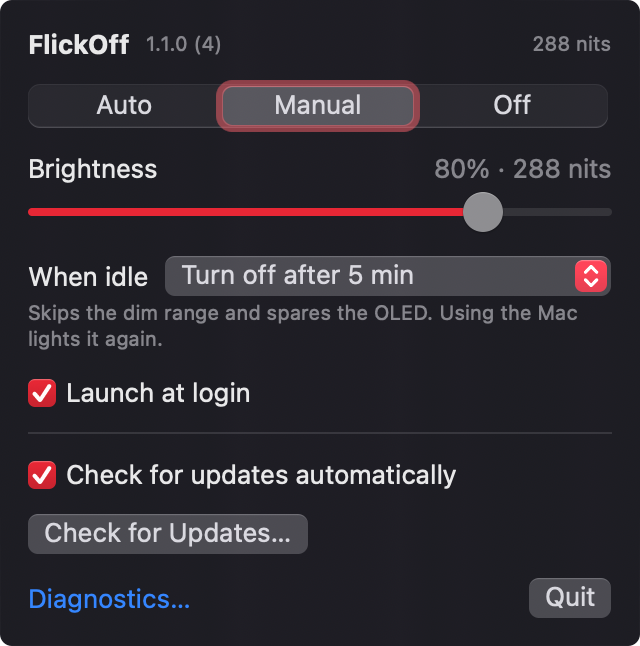

# FlickOff — Touch Bar brightness control for MacBook Pro

FlickOff is a macOS menu bar app for Apple silicon MacBook Pro models with a
Touch Bar. Adjust Touch Bar brightness separately from the screen, keep a higher
level when low brightness causes flickering, or turn off the Touch Bar display.

**Keep your Mac. Lose the flicker.**



[Download](#download-flickoff-for-apple-silicon-macs) ·
[Installation](docs/INSTALL.md) · [Troubleshooting](docs/TROUBLESHOOTING.md) ·
[Changelog](CHANGELOG.md) · [Security](SECURITY.md) · [Contributing](CONTRIBUTING.md)

## Download FlickOff for Apple silicon Macs

[Download the macOS installer (.dmg)](https://github.com/ZheMaxy/FlickOff/releases/download/v1.1.0-beta.2/FlickOff-1.1.0-arm64.dmg)
or [browse all releases](https://github.com/ZheMaxy/FlickOff/releases).
Open the disk image and open **Install FlickOff**.

**First launch:** this beta has not been notarized by Apple. If macOS says it
cannot verify the developer or check the app for malicious software, open
**System Settings → Privacy & Security**, find the blocked app, choose
**Open Anyway**, then confirm **Open**. If your macOS version shows **Security →
Open** first, open that section to find the exception. See the
[complete first-launch steps](docs/INSTALL.md#first-launch-if-macos-blocks-the-app).

Once the installer opens, review the license and choose **Agree and Install**.
Confirm the macOS administrator prompt. It installs FlickOff in Applications,
upgrades an existing copy, keeps your settings and opens the app in the menu bar.
If macOS also blocks **FlickOff** itself, repeat the first-launch steps for it.

This public beta is tested on an M1 MacBook Pro with macOS 27.2. The installer
app and FlickOff use local ad-hoc signatures rather than Developer ID signatures.
**You do not need an Apple Developer account or subscription to install it.**
Noncommercial use is free; commercial use requires a [paid license](COMMERCIAL.md).

### Or install with Homebrew

No first-launch steps and no administrator password. See
[what this means](docs/INSTALL.md#install-with-homebrew).

```sh
brew tap zhemaxy/flickoff https://github.com/ZheMaxy/FlickOff
brew install --cask zhemaxy/flickoff/flickoff
```

## Why it exists

**A flickering Touch Bar shouldn't ruin a perfectly usable MacBook.**

You're working in a dim room. The Touch Bar gets darker — and starts flashing.
A tiny strip above the keyboard keeps pulling your eyes away from the screen.
The rest of the laptop is fine, but using it has become irritating.

Then comes the frustrating part: **macOS gives you no separate manual brightness
slider for the Touch Bar itself.** Its brightness is managed automatically. The
brightness controls *on* the Touch Bar adjust the main screen, not the strip
that's flickering.

If you're looking at a repair bill for an otherwise useful Mac, here's a
software workaround to try first. No terminal commands for everyday use, no
administrator access to adjust brightness, and no need to stop system services.

This app started with the author's M1 MacBook Pro: its Touch Bar flickers at low
brightness, while a higher fixed level helps. It cannot repair a failing panel,
and it will not solve every kind of flicker. It gives you a practical way to
avoid the troublesome brightness range or stop using the display while deciding
what to do about hardware service.

## Adjust brightness or turn off the Touch Bar display

| Control | Behaviour |
| --- | --- |
| **Manual** | Disables automatic Touch Bar brightness and applies your chosen level. Start high, then lower it until comfortable and stable. |
| **Auto** | Returns brightness control to macOS. **When idle** still applies. |
| **Off** | Keeps the Touch Bar display dark while the app runs. Does not disable touch input or Touch ID. |
| **When idle: Turn off after 1, 5 or 15 min** | Keeps the panel lit while you use the Mac, then turns it off without passing through the dim range. Using the Mac lights it again. |
| **When idle: Stay lit** | Prevents idle dimming and idle display power-off while the Mac is awake, unlocked and open. |
| **When idle: Let macOS dim it** | Leaves idling to macOS, which can bring the flicker back. |
| **Launch at login** | Enabled on first launch; starts the app after login to reapply saved settings. |

First launch selects **Manual, 100%** and **Turn off after 5 min**, with launch
at login enabled. macOS may request login-item approval. Updates preserve your
choice if you turn launch at login off, and an installation from before **When
idle** existed keeps its behaviour until you choose another one.
**0% is the panel's minimum lit brightness, not Off.** Slider nits are estimated
from the reported panel range; the header shows reported physical output.

Settings are remembered locally. On normal quit or SIGTERM, the app restores the
brightness/auto-brightness settings it found at launch and releases Off when the
Mac is awake and unlocked. Crashes and force quits cannot guarantee restoration.

Keeping an OLED panel lit continuously can increase power use and burn-in risk.
Use the lowest stable brightness that works for you, and prefer turning off when
idle or Off to **Stay lit**.

Opening FlickOff while it is running, for example with Spotlight, shows the same
controls in a window, which helps if the menu bar icon is hidden. A second copy
quits and leaves the running one in charge. While another user has the screen
through fast user switching, FlickOff hands back the Touch Bar until you return.

## Supported MacBook Pro models and macOS versions

| Requirement | Status |
| --- | --- |
| Apple silicon MacBook Pro with Touch Bar | Required; the bundled app is arm64 only |
| M1 13-inch, 2020 (`MacBookPro17,1`) | Hardware tests passed on macOS 27.2; see [validation](docs/TESTING.md) |
| M2 13-inch, 2022 | Candidate hardware; not verified |
| Intel MacBook Pro, or a Mac without Touch Bar | Outside the current release scope |
| macOS 13 or later | Build/deployment minimum; private API compatibility must pass at runtime |

Earlier macOS versions have not been validated on hardware. A successful build
does not establish hardware support. The app uses private Apple frameworks;
macOS updates may change them. On an incompatible system it shows a report and
disables hardware controls. Read-only checks cannot prove that writes will work
or that visible flickering will stop.

## Touch Bar flickering and brightness FAQ

### How do I change Touch Bar brightness without changing screen brightness?

Open FlickOff from the menu bar, select **Manual**, and move the brightness
slider. It adjusts the Touch Bar itself. Your MacBook's main screen brightness
is controlled separately by macOS.

### Can FlickOff help when my Touch Bar flickers at low brightness?

On the author's M1 MacBook Pro, a higher fixed brightness avoids the range that
triggers flickering. Try Manual at a comfortable higher level. If idle dimming
brings the flicker back, set **When idle** to turn off or stay lit instead of
letting macOS dim it. If that does not help, try Off or seek hardware service.
This is a workaround, not a panel repair.

### How do I turn off the Touch Bar without disabling Touch ID?

Choose **Off**. FlickOff keeps the Touch Bar display dark while it runs;
Touch ID and touch input remain available. Setting brightness to 0% only selects
the minimum lit brightness. See [Off mode troubleshooting](docs/TROUBLESHOOTING.md)
if the display wakes briefly.

### Does FlickOff support M1 and M2 MacBook Pro?

The M1 13-inch MacBook Pro (2020) has been tested on macOS 27.2. The M2 13-inch
model is a candidate, but has not been verified. Intel Macs and Macs without a
physical Touch Bar are outside this release's scope. Check the support table
above before downloading.

### Is FlickOff free to use?

Noncommercial use is free under PolyForm Noncommercial 1.0.0. Business and other
commercial use require a [separate paid license](COMMERCIAL.md), subject to the
noncommercial license's terms and exceptions.

## Build and run

Install Xcode or Command Line Tools with **Swift 6.0 or later**. Sparkle 2.10.1
is pinned through Swift Package Manager; the first build downloads it. Its
licenses are preserved in [third-party notices](THIRD_PARTY_NOTICES.md).

```sh
git clone https://github.com/ZheMaxy/FlickOff.git
cd FlickOff
git config core.hooksPath .githooks
./build.sh
open build/FlickOff.app
```

`./build.sh` runs tests, builds an arm64 release app, verifies its ad-hoc signature,
checks setup guidance, and prints a read-only compatibility report. It does not
install or launch the app. A failed compatibility report is informational on a
build machine without a Touch Bar.

```sh
./build.sh test       # automated tests; no brightness/panel changes
./build.sh install    # build and open the native installer
```

For a managed environment reporting `sandbox_apply: Operation not permitted`,
use `SWIFTPM_DISABLE_SANDBOX=1 ./build.sh` to disable SwiftPM's nested build
sandbox. Ordinary builds leave it enabled. Release builds omit debug information.

Every push builds and tests natively on arm64 in CI, including a read-only check
of the private APIs and validation of the installer. The newest macOS image runs
the same weekly, the update feed is checked daily, and links and scripts are linted
on every change. CI runners have no Touch Bar: `scripts/preflight.py` runs the
hardware checks on a real Mac, and a release can't be signed without them.

Local builds are ad-hoc signed, not Developer ID signed or notarized. See
[installation and Gatekeeper](docs/INSTALL.md) before sharing a binary.

## In-app updates

Use **Check for Updates…** in the menu. **Check for updates automatically** is
enabled by default and can be switched off. An update found in the background
shows on the menu bar icon and at the bottom of the menu. Sparkle downloads
updates and handles installation from inside the app. The installer leaves the
app owned by the system, so installing an update asks for an administrator's
password; a Homebrew installation doesn't. **Include beta versions** decides whether
betas are offered once stable releases exist. Archives and the update feed are
Ed25519 signed and verified before installation. Update checks contact GitHub; system profiling is disabled. The
private signing key is never shipped.

## Diagnostics and tests

```sh
APP=build/FlickOff.app/Contents/MacOS/FlickOff
"$APP" --self-test     # read-only compatibility report; exit 0/1
"$APP" --setup-info    # setup guidance; no login-item registration
"$APP" --diagnose      # read-only report with saved settings and selected system information
```

**Diagnostics…** in the menu also offers explicit, optional hardware probes. Each
Run button temporarily changes brightness or panel state, then reapplies the
app's settings. The brightness probe includes a low level and may cause flicker.
Review reports before sharing. The app does not upload them automatically.

Ordinary tests cover settings, controller logic, idle power-off, sleep/lock
behaviour, user switching, slow services, failure paths, setup guidance, report
redaction and localization. Live checks are opt-in:

```sh
TB_API_TESTS=1 ./build.sh test
# Quit every running copy of the app before the next command:
TB_HARDWARE_TESTS=1 ./build.sh test
```

The [built-app integration script](Tests/Integration/README.md) additionally checks
the actual app process, its timer and shutdown cleanup.

Hardware tests briefly change the Touch Bar and attempt to restore it. They do
not prove visually that flickering has stopped. See [architecture](docs/ARCHITECTURE.md)
and [release checks](docs/RELEASING.md). Current results: [validation](docs/TESTING.md).

## License

Free for noncommercial use under **PolyForm Noncommercial 1.0.0**.
**Commercial use requires a separate paid commercial license from ZheMaxy.**
See [LICENSE](LICENSE), [NOTICE](NOTICE), and [commercial licensing](COMMERCIAL.md).

The source is available for inspection and noncommercial modification. This is
not an OSI open-source license. Public source access does not grant commercial rights.
